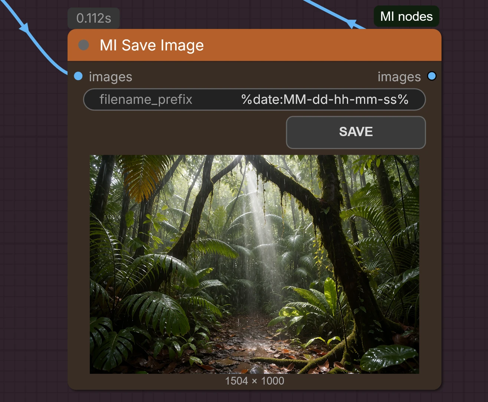

# MI Save Image

ComfyUI custom node. Receives one or several images and saves them to ComfyUI's `temp` folder (with preview).
The **SAVE** button copies the visible image (or all images in grid view) to the default `output` folder.

Filenames follow `filename_prefix`, default `%date:MM-dd-hh-mm-ss%` (tokens: `yyyy`, `yy`, `MM`, `dd`, `hh`, `mm`, `ss`).

## Install
Copy this folder to `ComfyUI/custom_nodes/` and restart ComfyUI.

## License

[MIT](LICENSE) © 2026 Thinkingbells
